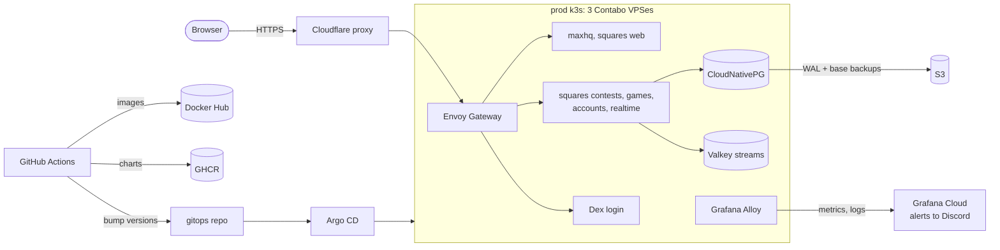

# maxhq

Monorepo for everything served under `maxhq.io`: the apps, their Helm charts, and the tooling for what runs outside the cluster.

| Path | What | Image |
| --- | --- | --- |
| [`apps/maxhq`](apps/maxhq) | Portfolio site (`maxhq.io`) | `maxmorhardt/maxhq` |
| [`apps/squares/web`](apps/squares/web) | Squares frontend (`squares.maxhq.io`) | `maxmorhardt/squares` |
| [`apps/squares/contests`](apps/squares/contests) | Squares contests service | `maxmorhardt/squares-contests` |
| [`apps/squares/games`](apps/squares/games) | Squares schedule and live scores | `maxmorhardt/squares-games` |
| [`apps/squares/accounts`](apps/squares/accounts) | Squares profiles and contact form | `maxmorhardt/squares-accounts` |
| [`apps/squares/realtime`](apps/squares/realtime) | Squares live updates (server-sent events) | `maxmorhardt/squares-realtime` |
| [`libs`](libs) | Go libraries shared by the services (`platform`, `squares`) | - |
| [`charts`](charts) | Helm chart for each app, the gateway, and the `cloudflare-cidr` alert | - |
| [`infra/terraform`](infra/terraform/README.md) | AWS backups, Cloudflare DNS, GitHub rulesets and environments | - |
| [`infra/k3s`](infra/k3s/README.md) | Node bootstrap and the k3s runbook | - |
| [`infra/cloudflare-maintenance`](infra/cloudflare-maintenance/README.md) | Maintenance page Worker | - |

Cluster state (which image and chart version each app runs, plus every infra component's values) lives in [`maxmorhardt/gitops`](https://github.com/maxmorhardt/gitops). Shared CI lives in [`maxmorhardt/workflows`](https://github.com/maxmorhardt/workflows).

## Architecture

Prod traffic comes in through Cloudflare's proxy. The squares services keep state in Postgres, which commits each change with an outbox event in the same transaction. A relay moves those events onto Valkey streams, where `realtime` fans them out to browsers over server-sent events. Dev is the same stack on four Raspberry Pis, reachable only over Tailscale.

## Releases

[release-please](https://github.com/googleapis/release-please) versions every app and every chart separately in [`release-please-config.json`](release-please-config.json), starting at 1.0.0. Images and charts deploy separately:

- **Dev**, on every merge to `main` ([`cd-dev.yml`](.github/workflows/cd-dev.yml)): changed apps build `sha-<commit>` images and set dev's `image.tag`; changed charts publish `0.0.0-sha-<commit>` to `oci://ghcr.io/maxmorhardt/charts` and set dev's chart version.
- **Prod**, on a release tag after approval ([`cd-prod.yml`](.github/workflows/cd-prod.yml)): `<app>/<version>` retags the image dev already built for that commit (never rebuilt) and sets prod's `image.tag`; `<chart>-chart/<version>` publishes the chart and sets prod's chart version.

One release pull request covers every app with pending changes. Pull requests are squash merged, so the PR title is the conventional commit release-please reads, and it applies to every app the PR touches.

## CI

[`ci.yml`](.github/workflows/ci.yml) runs on pull requests and only builds what changed; a change under `libs` tests every Go service, a changed chart is linted and rendered, and a change under `infra/terraform` plans every module. `CI Complete` is the single required check. [`cd-terraform.yml`](.github/workflows/cd-terraform.yml) applies Terraform on merge.

All Go code is one module: [`go.mod`](go.mod) at the root, so every service and library shares one set of dependency versions.

## Git hooks

[`.githooks/pre-commit`](.githooks/pre-commit) runs each UI's own lint-staged when its files are staged, and gofmt on staged Go files. `pnpm install` in either UI turns it on (`git config core.hooksPath .githooks`); there is no npm project at the root.

## Licenses

| Path | License |
| --- | --- |
| everything not listed below (`apps/maxhq`, `charts`, `infra`, CI, repo config) | Apache-2.0 ([`LICENSE`](LICENSE)) |
| `apps/squares/**` | PolyForm Noncommercial 1.0.0 (the `LICENSE` in each squares app) |
| `libs/**` | PolyForm Noncommercial 1.0.0 ([`libs/go/platform/LICENSE`](libs/go/platform/LICENSE), [`libs/go/squares/LICENSE`](libs/go/squares/LICENSE)); both were extracted from the squares API |

A directory's own `LICENSE` overrides the root one for everything under it.
